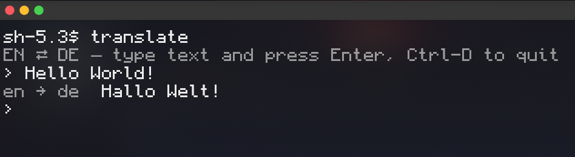

# translate



A small command-line wrapper around [Argos Translate](https://github.com/argosopentech/argos-translate)
for fast, offline English ⇄ German translation. It detects the input language on its own,
so you just type and get the other language back.

```console
$ translate Hallo Welt
Hello World

$ echo "Good morning" | translate
Guten Morgen

$ translate
EN ⇄ DE — type text and press Enter, Ctrl-D to quit
› Wie geht es dir?
de → en  How are you?
```

## Features

- **Automatic direction**: figures out whether the input is English or German.
- **Three ways to use it**: arguments, piped stdin, or an interactive prompt with readline history.
- **Fully offline**: everything runs locally through Argos Translate models.
- **Quick startup**: blocks the heavy `stanza`/`spacy` sentence splitters (which pull in PyTorch)
  so Argos falls back to the lightweight MiniSBD. In interactive mode the models load in the
  background while you type.

## Requirements

- Python 3.9+
- `argostranslate`, plus the two EN/DE language models:

```sh
pip install --user argostranslate
argospm update
argospm install translate-de_en translate-en_de
```

`argostranslate` has to be importable by the interpreter in the script's shebang
(`/usr/bin/python3`). If you installed it into a virtualenv, change the shebang to point
to that environment's Python.

## Installation

Put the script somewhere on your `PATH`, for example:

```sh
ln -s "$PWD/translate" ~/.local/bin/translate
```

## Usage

```
translate                   interactive: type a line, get the translation (Ctrl-D to quit)
translate Hallo Welt        translate the arguments
echo "Hello" | translate    translate standard input
translate -t de Hi there    force the target language (en or de)
```

When stderr is a terminal, the detected direction (e.g. `de → en`) is printed there in dim
text, so piping the output elsewhere only gives you the translation.

## How language detection works

1. **Heuristic score**: every word is checked against short lists of common German and
   English words, plus letter patterns typical of each language (`sch`, `ung`, umlauts vs.
   `th`, `ing`, `tion`, …). A clear score picks the direction immediately.
2. **Model vote**: if the score is too close to call (short or ambiguous input), the text
   is run through both models. A model fed text that is already in its target language
   mostly echoes it back, so the direction that changed the text more wins.

Use `-t en` or `-t de` to skip detection entirely.
